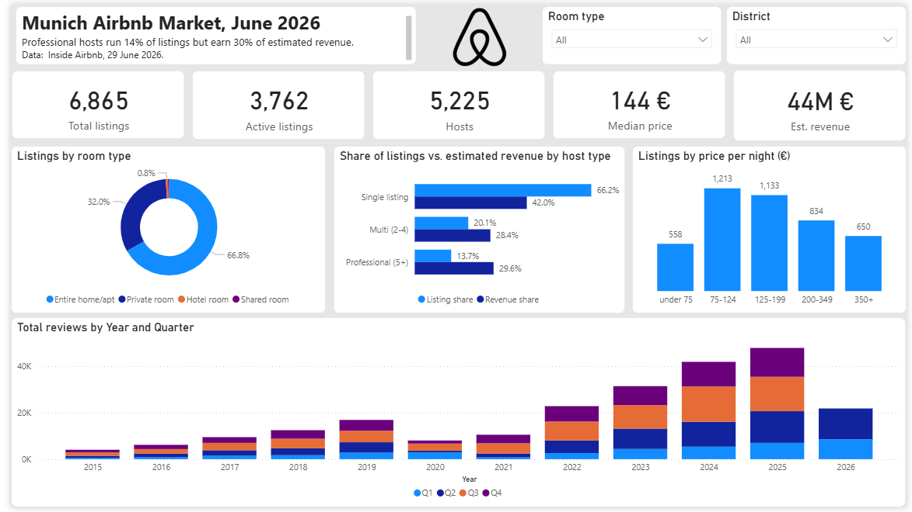
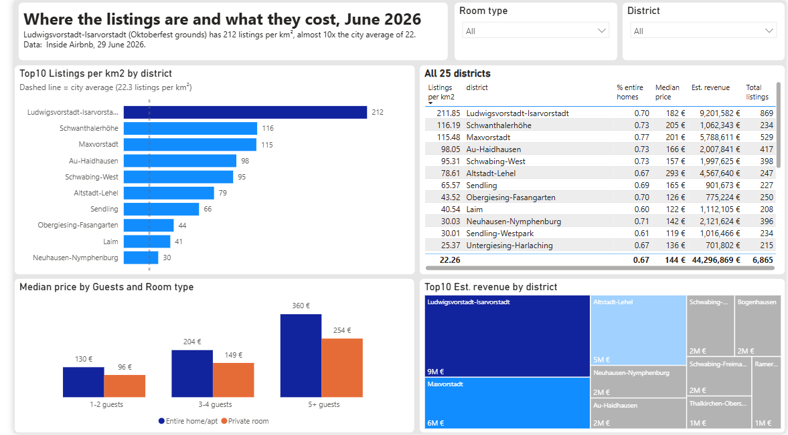
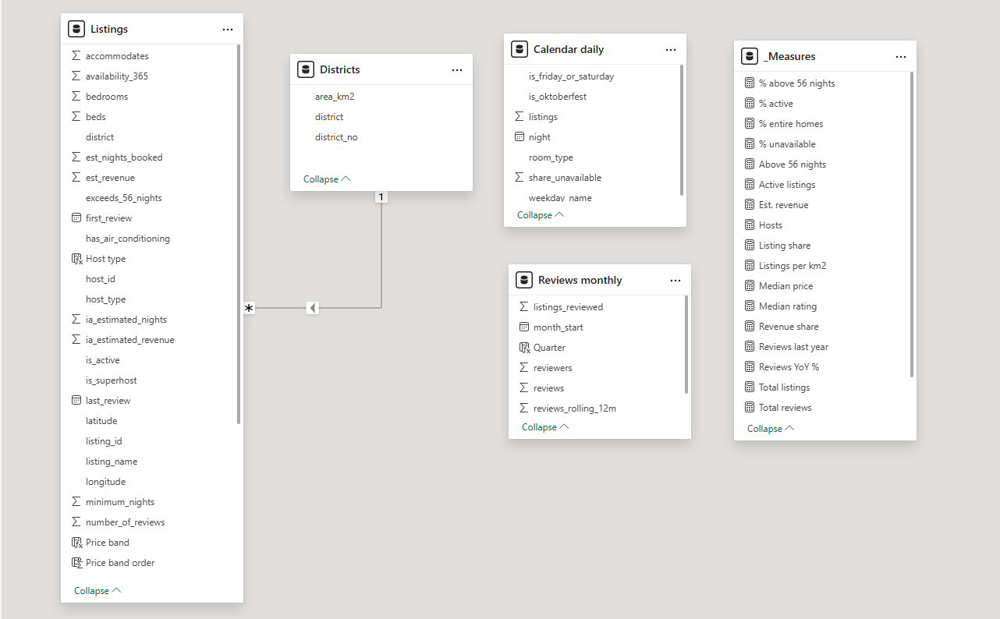

# Munich Airbnb Market 2026: Power BI report

A two-page Power BI report on Munich's short-term rental market, built on the PostgreSQL database from my SQL project **[munich-airbnb-sql](https://github.com/TMarkA/munich-airbnb-sql)**. SQL prepares and models the data; Power BI presents it.

**Data:** [Inside Airbnb](https://insideairbnb.com/get-the-data/), Munich, scraped 29 June 2026: 6,865 listings, 237,199 reviews.

## Report pages

### 1. Market overview


6,865 listings from 5,225 hosts, median price 144 € per night. Professional hosts (5+ listings) run **13.7% of listings but earn 29.6% of the estimated revenue**. Reviews, used as a proxy for stays, grew from 4,055 in 2015 to 47,919 in 2025, with a clear dip in 2020 (COVID) and the strongest quarter in Q3 (summer and Oktoberfest).

### 2. Districts and prices


Ludwigsvorstadt-Isarvorstadt, the district with the Oktoberfest grounds, has **212 listings per km²**, almost ten times the city average of 22. The three central districts Ludwigsvorstadt-Isarvorstadt, Maxvorstadt and Altstadt-Lehel earn **44% of all estimated revenue**. Altstadt-Lehel is the most expensive district at a median of 293 € per night.

## Data model



| Table | Source in PostgreSQL | Rows | Role |
|---|---|---|---|
| Listings | `mart.listings` (view) | 6,865 | one row per listing with host, price and occupancy estimate |
| Districts | `core.dim_district` | 25 | district area for listings per km² |
| Reviews monthly | `mart.reviews_monthly` (view) | 181 | reviews per month |
| Calendar daily | `mart.calendar_daily` (view) | 1,472 | share of unavailable listings per night |

One relationship: `Districts[district]` 1 → * `Listings[district]`. The summary tables were aggregated in SQL and stand alone. Only these small views are imported; the large review and calendar tables stay in PostgreSQL.

## DAX

All measures sit in a separate `_Measures` table; the full list is in [`dax/measures.dax`](dax/measures.dax). Examples:

```dax
Revenue share =
DIVIDE ( [Est. revenue], CALCULATE ( [Est. revenue], ALLSELECTED ( Listings ) ) )

Listings per km2 = DIVIDE ( [Total listings], SUM ( Districts[area_km2] ) )
```

Calculated columns give clean labels that still sort correctly (`Price band`, `Host type`) and group months into quarters (`Quarter`).

All key figures were checked against the query results in the SQL repository (`results/*.csv`).


A PDF export of the report is in [`munich_airbnb_report.pdf`](munich_airbnb_report.pdf).

## Notes on the estimates

- **Revenue** is estimated from reviews (Inside Airbnb's San Francisco model, explained in the SQL repo), not real booking data.
- **Reviews** stand in for stays: guests review after a stay, but not every guest leaves a review.
- **Prices** are the quotes shown on the scrape date. Outliers (under 15 € or over 2,000 €) and quotes for Oktoberfest dates are excluded from the median price.

## Tools

PostgreSQL · Power BI Desktop · Power Query · DAX

Author: Mark Tereshchenko, M.Sc. Operations Research & Business Analytics

